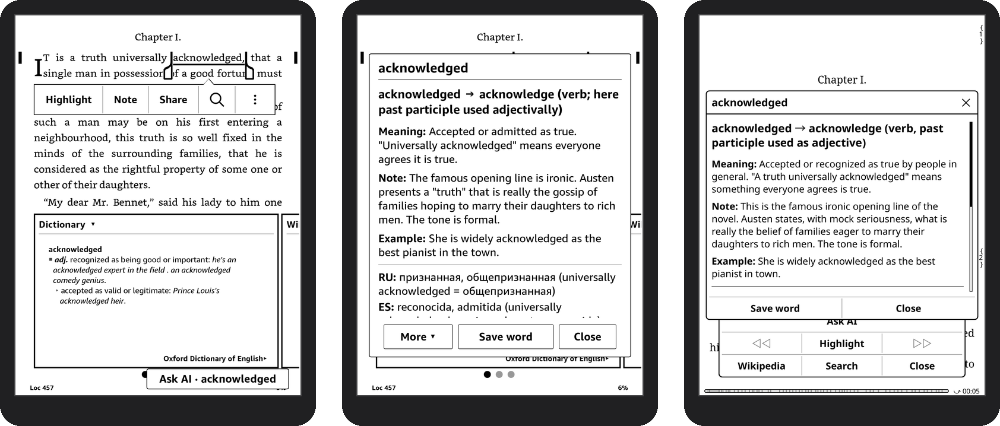
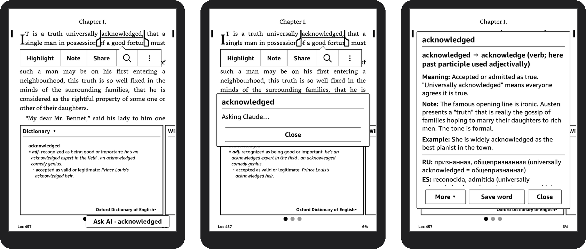
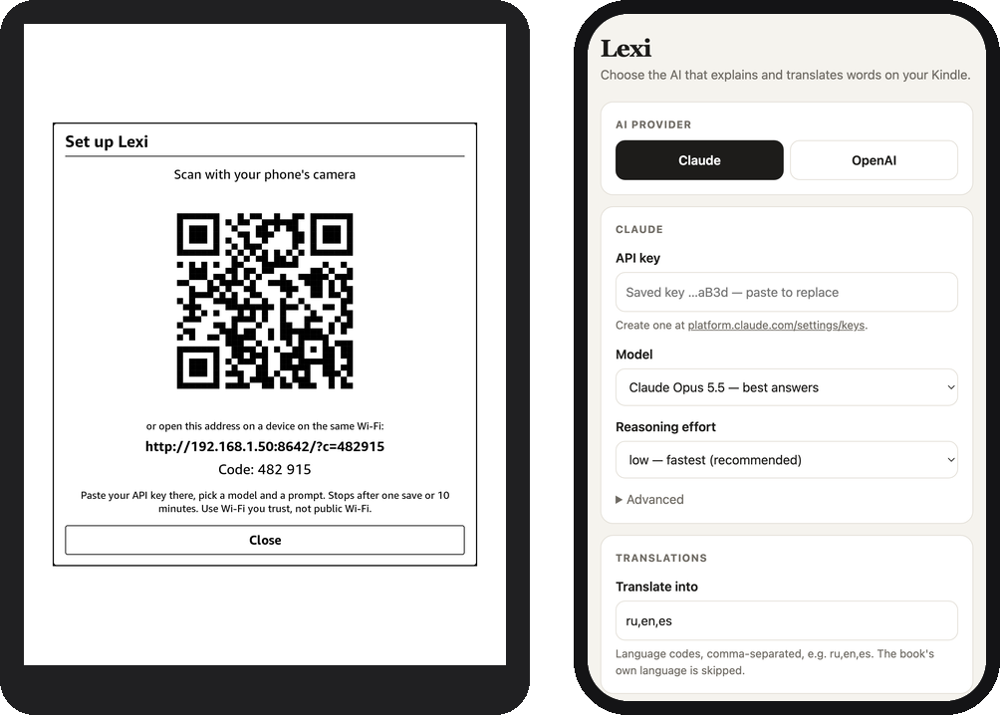
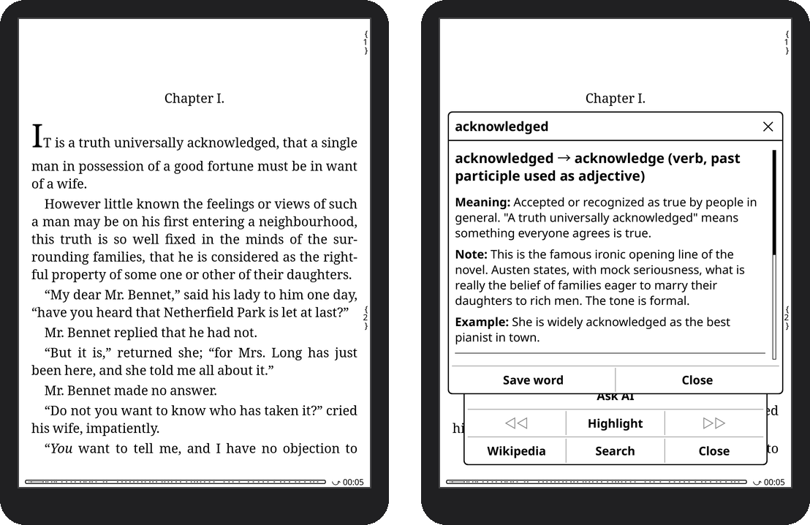

<div align="center">

# Lexi

**Long-press a word on your Kindle. Get what it means *in this sentence* and its translations, from Claude or GPT.**

Works in **KOReader** and in the **Kindle's own reader**.



[](LICENSE)


[**Download**](../../releases/latest) · [Install](#install) · [Set up](#set-up-from-your-phone) · [How it works](docs/how-it-works.md)

</div>

---

A dictionary tells you every meaning a word has. Lexi tells you **the one the author meant**: it sends the word, the sentence around it and the book's title to the AI you choose, and shows a short card:

- **the word in context** and its dictionary form
- **Meaning**, a **Note** on tone, usage or irony, and an **Example**
- **translations** into the languages you pick (Russian, Spanish, English… whichever you want)
- **Save word** keeps it in your list of words to learn

## Features

- 📖 **Kindle reader and KOReader.** In KOReader, *Ask AI* sits in the dictionary popup. In Amazon's own reader, an *Ask AI* button appears next to the built-in dictionary; turn it on from a Lexi item in your library.
- 🧠 **Claude or OpenAI.** Claude Opus, Sonnet or Haiku; GPT-6.1 Sol, Astra or Luna. You choose the reasoning effort.
- 🎛️ **Your kind of answer.** Pick a prompt: *Explain & translate*, *Explain like I'm 5*, *Translation only*, *Deep dive* or *Grammar*, or [write your own](#prompts) with placeholders like `{word}` and `{context}`. *Ask again as…* re-asks the same word with another prompt.
- 💸 **Pays once per word.** Look up a word you already asked about and Lexi shows the earlier answer straight away, without a new request. **Ask AI again** gets a fresh one.
- 📱 **Set up from your phone.** Scan a QR code on the Kindle and paste your API key on your phone. No typing a 100-character key on e-ink.
- 🌍 **Explains in the book's language.** English books get English explanations; Russian books get Russian ones. Translations go to every other language on your list.
- 🔖 **A word list.** Saved words keep their sentence, book and answer. You can sync them to your own backend (see [the contract](docs/how-it-works.md#your-own-backend)).
- 🔒 **Private by design.** Your key stays on your Kindle and goes only to the provider you chose, over certificate-checked HTTPS. No middleman server.



<p align="center"><sub>In Amazon's reader: long-press a word → <b>Ask AI · word</b> → the answer, with <b>Save word</b>.</sub></p>

## What you need

| | |
|---|---|
| **A jailbroken Kindle** | Any model the [kindlemodding.org](https://kindlemodding.org/) guide covers, with its **Universal Hotfix** (recent jailbreaks install it for you). That is what lets the Kindle library run [scriptlets](https://kindlemodding.org/kindle-dev/scriptlets.html), which is how Lexi's library items work. |
| **KOReader** | On a recent jailbreak, turn Wi-Fi on and type `;kpm install koreader` in the Kindle's search bar; otherwise follow the [guide](https://kindlemodding.org/jailbreaking/whats-next/getting-koreader/). Lexi runs on it, even when you read in Amazon's reader. Firmware 5.16.3 and newer needs the `kindlehf` build. |
| **An API key** | From [Anthropic](https://platform.claude.com/settings/keys) or [OpenAI](https://platform.openai.com/api-keys). Pay-as-you-go: a lookup costs a fraction of a cent (see [Cost](#cost)). |
| **Wi-Fi** | Only when you ask. Reading and dictionary lookups work offline as always. |

> [!NOTE]
> **Tested on** a Kindle Paperwhite (12th generation) with firmware 5.18.6 and KOReader 2026.07.1. The KOReader part uses only KOReader's plugin API. The Kindle-reader part builds on firmware internals (see [How it works](docs/how-it-works.md)), so other firmware versions may behave differently. Reports are welcome.

## Install

1. **Download** `lexi-x.y.z.zip` from the [latest release](../../releases/latest).
2. **Connect your Kindle** to your computer with USB.
   - Windows and Linux show it as a drive or a device.
   - Newer Kindles use MTP on macOS: use [OpenMTP](https://openmtp.ganeshrvel.com/) or *Android File Transfer*.
3. **Copy the folders from the zip to the root of the Kindle's storage.** They merge into folders that already exist:

   ```
   koreader/plugins/lexi.koplugin/   → the KOReader plugin (everything Lexi does)
   documents/lexi-ask-ai.sh          → "Lexi: Ask AI on/off" in your Kindle library
   documents/lexi-setup.sh           → "Lexi: Set up from phone" in your Kindle library
   ```

4. **Eject** the Kindle. The two **Lexi** items appear in your library like books. If KOReader was open, restart it: menu → *Exit* → *Restart KOReader*.

To **update**, copy the new zip over the old folders. Your settings and saved words live elsewhere (`koreader/settings/lexi*.lua`) and are kept.

## Set up from your phone

You need an API key once. Create one at [platform.claude.com](https://platform.claude.com/settings/keys) or [platform.openai.com](https://platform.openai.com/api-keys); a monthly spend limit is a good idea. Then:

1. On the Kindle, with Wi-Fi on, do one of these:
   - in your **library**, tap **Lexi: Set up from phone**;
   - in **KOReader**, open the top menu → 🔧 *Tools* → **Lexi** → **Set up from phone (QR code)**.
2. **Scan the QR code** with your phone's camera (the phone must be on the same Wi-Fi).
3. **Paste your API key**, pick the model, reasoning effort, translation languages and [prompt](#prompts), and tap **Save to Kindle**.



The page only works with the 6-digit code shown on the Kindle. It stops after one save or 10 minutes, and of a saved key it only ever shows the last 4 characters. It is plain HTTP on your local network, so use it on Wi-Fi you trust.

<details>
<summary>Prefer a file, or typing on the Kindle?</summary>

- **On the Kindle:** KOReader → Tools → Lexi → *Claude settings* / *OpenAI settings* → *API key*.
- **As a file:** copy `koreader/plugins/lexi.koplugin/config.example.lua` to `config.lua` in the same folder and fill it in. Values set from the menus override it.

</details>

## Use it

### In KOReader

Long-press a word. In the dictionary popup, tap **Ask AI**. You can also select several words (long-press and drag) and tap **Ask AI** in the selection menu. Under the answer, **Ask again as…** asks once more with another [prompt](#prompts).



> If **Ask AI** is missing from the dictionary popup, you have customized its buttons before. Turn it on in the popup's menu → *Customize buttons*.

### In the Kindle's own reader

1. In your library, tap **Lexi: Ask AI on/off**. A short message confirms *Ask AI in Kindle reader: ON*. Do this once after each restart of the Kindle.
2. Read as usual. When you long-press a word, the Kindle's dictionary opens and a small **Ask AI · word** button appears in the bottom-right corner.
3. Tap it. **Save word** adds the word to the same list KOReader shows. **More** pages through long answers. **Ask again as…** asks once more with another [prompt](#prompts).

The button only appears for single-word lookups, and the AI is only asked when you tap it, so looking words up stays free. On firmware 5.18 the Kindle opens some books, such as ones bought from Amazon, in a newer reader with a different dictionary popup; Lexi works in both.

### Words you asked about before

Lexi keeps every answer. Ask about the same word again, with the same prompt, and it shows the earlier answer at once, with no request and no cost. This works in both readers and also offline. A line above the answer says when it was given, and **Ask AI again** asks for a new one, which then replaces it.

The word counts as the same whatever its capitalization or the sentence around it. A different prompt, book language or *Translate into* list gets its own answer. Lexi keeps the newest 500 answers in `koreader/settings/lexi_answers.lua`. To forget them all, delete that file and its backup, `lexi_answers.lua.old`.

### Changing settings

You can change the provider, model, reasoning effort, languages and prompt in two places:
- the phone setup page;
- KOReader's menu (Tools → Lexi), which also lists your saved words.

## Settings

| Setting | Options | Default |
|---|---|---|
| AI provider | Claude, OpenAI, your own backend | Claude |
| Claude model | Opus 5.5 (best answers), Sonnet 5.5 (balanced), Haiku 5.5 (fastest, cheapest), or any model ID | Opus 5.5 |
| OpenAI model | GPT-6.1 Sol (balanced), GPT-6 Astra (most capable), GPT-6 Luna (fastest, cheapest), or any model ID | GPT-6.1 Sol |
| Reasoning effort | low (fastest), medium, high | low |
| Translate into | language codes, e.g. `ru,en,es`; the book's own language is skipped | `ru,en,es` |
| Prompt | Explain & translate, Explain like I'm 5, Translation only, Deep dive, Grammar, or [your own](#your-own-prompts) | Explain & translate |
| My backend | URL and device token of a server of your own: saved words sync to it, and as the AI provider it answers lookups too ([contract](docs/how-it-works.md#your-own-backend)). Set it in KOReader → Tools → Lexi → *My backend*. | not set |

### Cost

A lookup sends about 600 tokens (the sentence, the book and instructions) and gets about 200 back. Approximate cost per lookup:

| Model | Per lookup | 50 lookups a day for a month |
|---|---|---|
| Claude Haiku 5.5 · GPT-6 Luna | ~$0.0002 | ~$0.25 |
| GPT-6.1 Sol | ~$0.003 | ~$4.50 |
| Claude Opus 5.5 | ~$0.006 | ~$9 |
| GPT-6 Astra | ~$0.015 | ~$22 |

Prices change; check [Anthropic](https://www.anthropic.com/pricing) and [OpenAI](https://openai.com/api/pricing/). *Deep dive* answers are about twice as long and cost more. A word you [asked about before](#words-you-asked-about-before) costs nothing.

## Prompts

The prompt decides what kind of answer you get. Choose it in KOReader (Tools → Lexi → **Prompt**) or on the phone setup page; it applies in both readers. To try another one for a single word, tap **Ask again as…** under the answer.

| Prompt | What you get |
|---|---|
| **Explain & translate** *(default)* | The meaning in this context, a note on tone or usage, an example and translations. |
| **Explain like I'm 5** | Very simple words, an everyday comparison and an easy example. |
| **Translation only** | Just the translations that fit this passage. |
| **Deep dive** | Meaning, origin, synonyms, register and more examples. |
| **Grammar** | The form used here, how it is built and why. |

All of them explain in the book's language and translate into your languages.

### Your own prompts

You can add up to 10 of your own:
- in KOReader: Tools → Lexi → Prompt → **Add custom prompt…** (long-press one of yours to edit or delete it);
- on the phone setup page: **Prompt** → **Add a prompt**.

Write what you would ask the AI yourself, with placeholders that Lexi fills in for each word:

| Placeholder | Becomes |
|---|---|
| `{word}` | the word or phrase you selected |
| `{context}` | the passage around it, with the selection marked ⟦ ⟧ |
| `{before}` · `{after}` | the text before · after the selection |
| `{book}` · `{author}` | the book's title · author |
| `{book_language}` | the book's language, e.g. English (or unknown) |
| `{explain_language}` | the book's language, or "the language of the passage" |
| `{translate_to}` | your translation languages except the book's, e.g. Russian, Spanish |

For example:

```
Explain “{word}” as it is used in this passage, in two short sentences in {explain_language}:
{context}

Then translate it into {translate_to}.
```

A prompt needs `{word}` or `{context}` and can be up to 2,000 characters long. Placeholders Lexi doesn't know are sent as you wrote them. Answers to your own prompts are shown as plain text.

## Privacy and security

- **What is sent:** the word, about 40 words around it (in Amazon's reader: the sentence the Kindle saved for the lookup), the book's title and author, and your language list. It goes straight to the provider you chose. Your own prompts send their text with the placeholders filled in, and nothing else. If you set up [your own backend](docs/how-it-works.md#your-own-backend), the words you save go to it too, with their sentence, book and answer.
- **What is kept:** the answers, on the Kindle only (`koreader/settings/lexi_answers.lua`), so that a word you look up again is free. Saved words are kept in `lexi_words.lua`.
- **Where your key lives:** in plain text in `koreader/settings/lexi.lua` on the Kindle (or `config.lua` if you used the file). Anyone with your Kindle and a USB cable can read it, so use a key with a spend limit.
- **HTTPS:** Lexi checks the provider's certificate chain against KOReader's CA bundle, and that the certificate belongs to the provider's host name. KOReader's default is not to check.
- **Phone setup:** see [above](#set-up-from-your-phone).
- No analytics, no Lexi server.

## Troubleshooting

<details>
<summary><b>"Ask AI" doesn't appear in Amazon's reader</b></summary>

- Turn it on: tap **Lexi: Ask AI on/off** in your library. It turns off when the Kindle restarts.
- It needs a dictionary lookup of a single word. Selecting several words doesn't trigger it.
- It also needs Amazon's dictionary to answer. If the popup shows no definition, see the next item.
- The log is `/var/tmp/lexi.log` (over SSH).

</details>

<details>
<summary><b>Some books open slowly and Amazon's dictionary shows nothing</b></summary>

On firmware 5.18, books from Amazon open in a newer reader, which needs the Kindle's serial number to load the dictionary. If a system helper gets stuck, every request for the serial number waits for seconds and fails: books open slowly, the dictionary popup comes up empty or late, and Lexi has no word to offer. Restarting the Kindle fixes it. Over SSH, `lipc-get-prop com.lab126.system usid` should answer at once. This isn't caused by Lexi; see [How it works](docs/how-it-works.md#1-finding-a-signal-when-a-word-is-looked-up).

</details>

<details>
<summary><b>The Lexi items don't show up in the library</b></summary>

- The Kindle adds new files to the library when you eject it after copying, and again after you leave KOReader (KOReader pauses the library scanner while it runs).
- They need scriptlet support from the [Universal Hotfix](https://kindlemodding.org/kindle-dev/scriptlets.html). Without it, use KOReader's menu for setup.

</details>

<details>
<summary><b>"Wi-Fi is off" or "Network error"</b></summary>

Turn Wi-Fi on and ask again. A *certificate verify failed* error means something on the network intercepted HTTPS (a captive portal, for example): sign in to the network first.

</details>

<details>
<summary><b>"HTTP 401" / "HTTP 400 … not scoped to a workspace"</b></summary>

- **401:** the key is wrong or was revoked. Set it up again from your phone.
- **400 … workspace:** your Claude key spans several workspaces. Add the workspace ID on the phone page under *Advanced*.

</details>

## How it works

The KOReader side is a regular Lua plugin. The Kindle-reader side needed some reverse engineering. Amazon's dictionary popup lives inside the Java framework, and no event reveals the word. But every lookup is written to the Vocabulary Builder database together with its sentence, and the firmware ships the GTK and WebKit libraries its own interface is built on. Lexi watches for the lookup and shows its button and answer in a small window of its own, without modifying the system partition. The full story is in **[docs/how-it-works.md](docs/how-it-works.md)**.

## Development

```bash
luajit tests/run.lua                                  # unit tests (pure Lua, no Kindle needed)
KINDLE_HOST=192.168.1.50 scripts/deploy.sh            # deploy to a Kindle over SSH
scripts/package.sh                                    # build dist/lexi-<version>.zip
```

See **[docs/development.md](docs/development.md)** for the layout, the on-device tooling and releases. Pull requests are welcome.

## Roadmap

- [ ] Start *Ask AI in Kindle reader* automatically at boot
- [ ] Install with [KPM](https://kindlemodding.org/kindle-dev/kpm/index.html) (`;kpm install lexi`)
- [ ] A companion app or backend for the saved word list (the [contract](docs/how-it-works.md#your-own-backend) is ready)
- [ ] Phrase lookups (several words) in Amazon's reader
- [ ] Streamed answers

## License and credits

Lexi is free software under the [GNU AGPL-3.0](LICENSE), the same license as KOReader.

It builds on [KOReader](https://github.com/koreader/koreader), the [kindlemodding.org](https://kindlemodding.org/) guides and the MobileRead community. QR codes come from [luaqrcode](https://github.com/speedata/luaqrcode), shipped with KOReader.

Lexi is not affiliated with Amazon, Anthropic or OpenAI. Kindle is a trademark of Amazon.com, Inc. Jailbreaking may void your warranty; you do it at your own risk.
